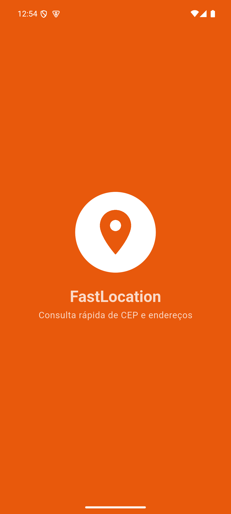
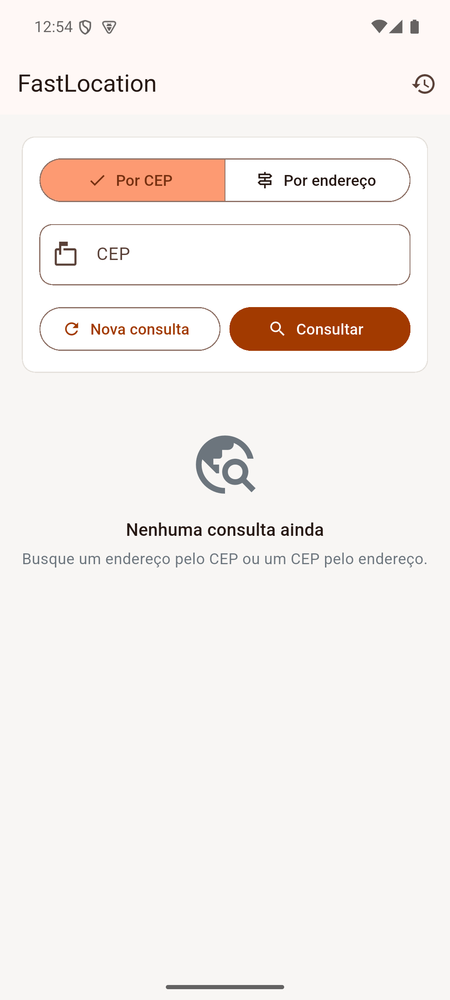
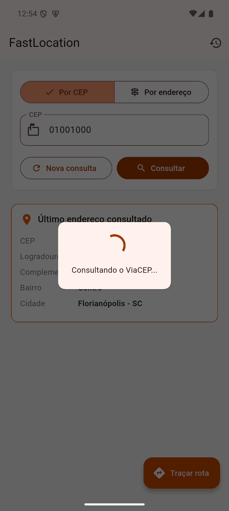
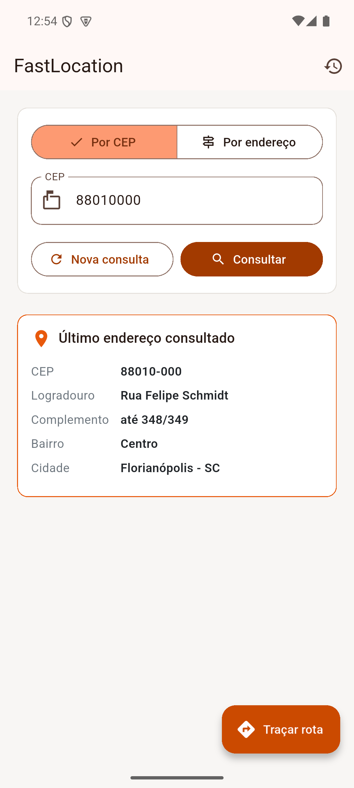
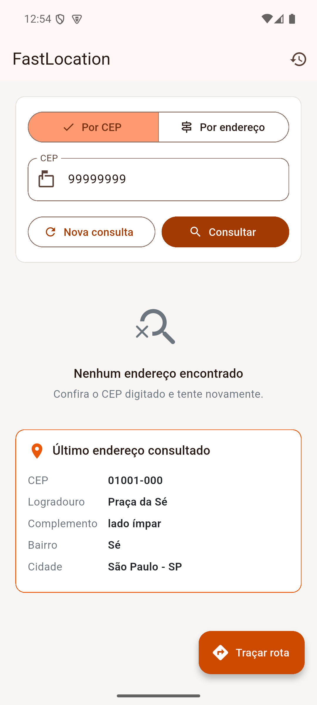
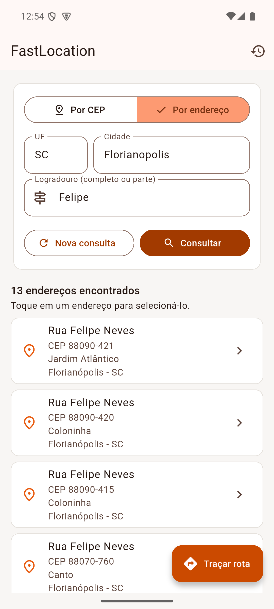
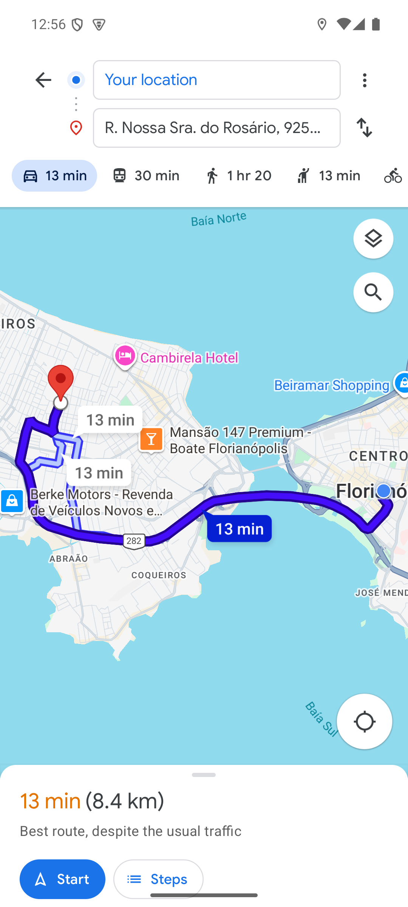

# FastLocation

Aplicativo Flutter para Android e iOS que permite aos entregadores da **FastDelivery** consultar o endereço de um CEP e descobrir o CEP de um endereço completo ou parcial, sem precisar ligar para a matriz.

Desafio da unidade curricular **Desenvolvimento de Sistemas Móveis** (UniSENAI SC, Análise e Desenvolvimento de Sistemas).
Autor: Daniel Barrili Dal Piva.

## Funcionalidades

| Requisito do desafio | Como foi atendido |
|---|---|
| Comunicação com API pública de CEP e endereços | [ViaCEP](https://viacep.com.br) via `dio`: `/ws/{cep}/json/` e `/ws/{UF}/{cidade}/{logradouro}/json/` |
| Armazenamento local para consultas recorrentes | Hive guarda cada endereço consultado. Um CEP já consultado é respondido pelo aparelho, sem nova chamada à API |
| Gerenciamento de estado reativo | MobX com `Observer` nas telas e `reaction` para exibir erros |
| Componente com campos para consulta | `SearchForm`: busca por CEP ou por UF, cidade e logradouro |
| Componente com o retorno da consulta | `LastAddress` (último endereço consultado) e `AddressList` (resultados da busca por endereço) |
| Tela de loading durante a consulta externa | `LoadingOverlay` cobre a tela enquanto o ViaCEP responde |
| Componente para resultado não encontrado | `EmptySearch` |
| Tela de histórico de endereços consultados | `HistoryPage`, carregada automaticamente ao abrir, com opção de limpar |
| Rota da localização atual até o último endereço | `geocoding` converte o endereço em coordenadas e `map_launcher` abre o app de mapas com a rota a partir da posição atual |

## Tecnologias

- Flutter 3.47.9 (Dart 3.13.7)
- dio, mobx, flutter_mobx, hive, hive_flutter, path, path_provider, map_launcher, geocoding
- mobx_codegen, hive_generator e build_runner para geração de código

## Estrutura

```
lib/
├── main.dart                         inicializa o Hive e sobe o app
└── src/
    ├── app_widget.dart               MaterialApp, tema, rotas e montagem das dependências
    ├── http/app_http_client.dart     configuração do dio (URL base e timeouts)
    ├── routes/app_routes.dart        nomes das rotas
    ├── shared/
    │   ├── colors/                   paleta do app
    │   ├── components/               AddressTile, AppTextField, LoadingOverlay
    │   ├── metrics/                  espaçamentos, raios e tamanhos
    │   └── storage/                  configuração do Hive
    └── modules/
        ├── initial/page/             tela de abertura animada
        ├── home/
        │   ├── components/           SearchForm, LastAddress, AddressList, EmptySearch
        │   ├── controller/           HomeController (MobX)
        │   ├── model/                AddressModel (adapter do Hive gerado)
        │   ├── page/                 HomePage
        │   ├── repositories/         ViaCepRepository (API) e AddressLocalRepository (Hive)
        │   └── service/              AddressService (regras de consulta) e RouteService (rota)
        └── history/
            ├── controller/           HistoryController (MobX)
            └── page/                 HistoryPage
test/                                 testes do service e do controller
```

## Como executar

Pré-requisitos: Flutter 3.47 ou superior, Android SDK e um emulador ou aparelho Android conectado (`flutter doctor` deve estar sem erros na parte Android).

```bash
git clone https://github.com/Danielpk17/fastlocation.git
cd fastlocation
flutter pub get
dart run build_runner build --delete-conflicting-outputs
flutter run
```

Os arquivos `*.g.dart` já estão no repositório, então o passo do `build_runner` só é obrigatório se o model ou os controllers forem alterados.

Para rodar os testes:

```bash
flutter test
```

No Windows, se o nome do usuário tiver acento, clone o projeto numa pasta simples (por exemplo `C:\dev`) e defina `PUB_CACHE=C:\dev\.pub-cache` e `GRADLE_USER_HOME=C:\dev\.gradle`. O `path_provider_android` usa o pacote `jni`, que compila código nativo com CMake dentro do cache do pub, e o ninja não aceita caracteres acentuados no caminho.

## Como usar

1. A tela de abertura anima o logo e leva para a tela inicial.
2. **Por CEP:** digite os 8 números e toque em Consultar. O endereço aparece no cartão "Último endereço consultado".
3. **Por endereço:** informe UF, cidade e parte do logradouro (mínimo de 3 letras, regra do ViaCEP). Toque no endereço desejado da lista para selecioná-lo.
4. **Nova consulta** limpa os campos e o resultado.
5. O ícone de relógio na barra superior abre o **histórico**.
6. **Traçar rota** abre o app de mapas instalado (Google Maps tem prioridade) com a rota da posição atual até o último endereço consultado. Se não houver app de mapas, o app avisa. No emulador, a posição atual pode ser definida com `adb emu geo fix <longitude> <latitude>`.

O geocoding do Android devolve uma coordenada aproximada do logradouro. Por isso o Google Maps pode rotular o destino com o nome de uma rua vizinha, embora o ponto no mapa esteja no endereço consultado.

## Telas

| Abertura | Início | Consultando | CEP encontrado |
|---|---|---|---|
|  |  |  |  |

| Não encontrado | Busca por endereço | Histórico | Rota |
|---|---|---|---|
|  |  |  |  |

## Diferenças em relação às versões do enunciado

As versões pedidas no desafio foram mantidas como limite mínimo (`^`), com duas exceções. As versões pedidas são de 2021 e 2022, e os plugins abaixo não compilam mais com o Android Gradle Plugin atual:

| Biblioteca | Pedido | Usado | Motivo |
|---|---|---|---|
| map_launcher | ^2.2.1+1 | ^4.6.0 | A série 2.x usa Android Gradle Plugin 3.5 e não declara `namespace`, o que o Gradle 8 exige. A API usada (`installedMaps` e `showDirections`) é a mesma. |
| geocoding | ^2.1.1 | ^4.0.0 | A série 2.x usa o `geocoding_android` 3.x, compilado contra o Android 33, e as bibliotecas AndroidX atuais exigem 34 ou mais. A 4.0.0 compila contra o 35. A função usada (`locationFromAddress`) é a mesma. |

Observações sobre as demais:

- **path_provider_ios** está descontinuado e foi substituído pelo `path_provider_foundation`, que o `path_provider` já usa. Foi mantido no `pubspec.yaml` porque o desafio pede.
- **dio 4.0.6** tem um alerta de segurança (GHSA-9324-jv53-9cc8): injeção de CRLF quando o método HTTP vem de texto controlado pelo usuário. O app só faz `GET` com método fixo, então não é afetado. A correção está no dio 5.
- **hive_generator 2.0.1** limita o `analyzer` à versão 6.x. Por isso o `build_runner` mostra o aviso "analyzer version may not fully support your current SDK version". O código é gerado normalmente.
